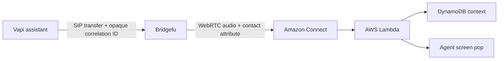

<div align="center">
  

# Bridgefu

**Connect anything.**

</div>

Bridgefu is a Rust media gateway that terminates two call legs and bridges
audio, DTMF, and explicitly allowed context between them. It is built on
[rvoip](https://github.com/eisenzopf/rvoip) and is designed to connect voice AI,
SIP, WebRTC, provider call control, and contact-center systems without making
either side understand the other.

The first product-qualified deployment target is a Vapi SIP transfer into
Amazon Connect with a correlated agent screen pop:



## Deploy Vapi transfers to Amazon Connect

The customer CloudFormation template, AMI build, Lambdas, Vapi provisioning,
and full live qualification harness live in the dedicated
[bridgefu-vapi-awsconnect](https://github.com/eisenzopf/bridgefu-vapi-awsconnect)
repository. That is the canonical place to deploy and operate this integration.

This repository owns the Bridgefu runtime and its built-in declarative recipe
contract. The deployment repository pins an immutable Bridgefu commit and
builds the customer AMIs from it.

## SIP security modes

- `sips_srtp` — TLS signaling and SDES-SRTP are required. This is the secure
  default.
- `sips_optional_srtp` — TLS signaling is required; Bridgefu negotiates SRTP
  when the peer offers it and accepts RTP/AVP otherwise. Use this deliberately
  for peers such as the currently observed Vapi transfer path that do not offer
  SRTP in SDP.
- `sip_rtp` — clear SIP and RTP. This is an explicit diagnostic compatibility
  posture, not the production default.

Every SIPS recipe uses one-use managed attachment URIs and a DNS `sips:`
Contact. Bridgefu does not silently downgrade signaling from TLS.

## Deployment status

Bridgefu has been operated in production in exactly **one** configuration:

- a **single all-in-one instance** (`runtime.mode: all-in-one`),
- SQLite persistence on local disk,
- running the `vapi-amazon-connect-screen-pop` recipe,
- deployed by [bridgefu-vapi-awsconnect](https://github.com/eisenzopf/bridgefu-vapi-awsconnect)
  as one EC2 instance, dual-region qualified with signed live-call evidence.

Everything else in this repository is implemented and unit-tested, but **has
never been deployed**:

| Capability | Status |
|---|---|
| Single all-in-one instance, SQLite | **Proven.** Live dual-region qualification evidence |
| Gateway/worker split, PostgreSQL + Redis coordination, private egress | Implemented; conformance tests run against real PostgreSQL 17 and Redis 7.2 in CI. Never deployed |
| Telnyx call control | Implemented; hermetic tests only. No live carrier evidence |
| UCTP fanout, MOQT relay | Implemented; end-to-end qualification is **manual-only and does not run in CI**. Treat as experimental |

Multi-node operation is unproven. The `cluster` Compose profile exists so the
gateway/worker code has a local harness, not because that topology has been
run in anger.

## Local development

Bridgefu pins the coordinated crates.io rvoip package graph exactly at `0.3.8`;
there are no Git, path, or local rvoip overrides.

```bash
cargo test --locked
cargo clippy --locked --all-targets -- -D warnings
```

Inspect the embedded, credential-free recipe catalog with:

```bash
cargo run -- recipe available
cargo run -- recipe show builtin:vapi-amazon-connect-screen-pop@1
cargo run -- recipe validate builtin:vapi-amazon-connect-screen-pop@1 \
  --values recipes/vapi-amazon-connect-screen-pop/values.example.yaml
```

Every built-in recipe is compiled, fingerprinted, and negative-tested by
`tests/recipe_matrix.rs`, which also validates the exact production
configuration shape that the downstream AMI ships:

```bash
make recipe-matrix
```

`sdk/typescript` (`@bridgefu/webrtc-browser`) is the reference browser client
for the WebRTC leg of any recipe. It is a generic rvoip signaling client with
no deployment-specific coupling, so it doubles as the test client for the
`webrtc-sip-bridge` and `sip-webrtc-bridge` recipes. See
[docs/recipes.md](docs/recipes.md) for what each recipe still needs before it
can be promoted past `preview`.

Low-level configuration remains available for custom integrations. Start with
[the product overview](docs/product-overview.md), [architecture](docs/architecture.md),
[configuration schema](config/schema.json), and [security model](docs/security.md).

Bridgefu is MIT licensed. See [CONTRIBUTING.md](CONTRIBUTING.md) for development
and security-reporting expectations.
