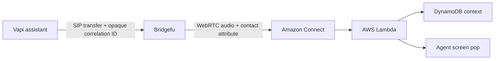

<div align="center">
  

# Bridgefu

**Connect anything.**

</div>

Bridgefu is a Rust media gateway that terminates two call legs and bridges
audio, DTMF, and explicitly allowed context between them. It is built on
[rvoip](https://github.com/eisenzopf/rvoip) and is designed to connect voice AI,
SIP, WebRTC, provider call control, and contact-center systems without making
either side understand the other.

The first product-qualified deployment target is a Vapi SIP transfer into
Amazon Connect with a correlated agent screen pop:



## Deploy Vapi transfers to Amazon Connect

The customer CloudFormation template, AMI build, Lambdas, Vapi provisioning,
and full live qualification harness live in the dedicated
[bridgefu-vapi-awsconnect](https://github.com/eisenzopf/bridgefu-vapi-awsconnect)
repository. That is the canonical place to deploy and operate this integration.

This repository owns the Bridgefu runtime and its built-in declarative recipe
contract. The deployment repository pins an immutable Bridgefu commit and
builds the customer AMIs from it.

## SIP security modes

- `sips_srtp` — TLS signaling and SDES-SRTP are required. This is the secure
  default.
- `sips_optional_srtp` — TLS signaling is required; Bridgefu negotiates SRTP
  when the peer offers it and accepts RTP/AVP otherwise. Use this deliberately
  for peers such as the currently observed Vapi transfer path that do not offer
  SRTP in SDP.
- `sip_rtp` — clear SIP and RTP. This is an explicit diagnostic compatibility
  posture, not the production default.

Every SIPS recipe uses one-use managed attachment URIs and a DNS `sips:`
Contact. Bridgefu does not silently downgrade signaling from TLS.

## Deployment status

Bridgefu has been operated in production in exactly **one** configuration:

- a **single all-in-one instance** (`runtime.mode: all-in-one`),
- SQLite persistence on local disk,
- running the `vapi-amazon-connect-screen-pop` recipe,
- deployed by [bridgefu-vapi-awsconnect](https://github.com/eisenzopf/bridgefu-vapi-awsconnect)
  as one EC2 instance, dual-region qualified with signed live-call evidence.

Everything else in this repository is implemented and unit-tested, but **has
never been deployed**:

| Capability | Status |
|---|---|
| Single all-in-one instance, SQLite | **Proven.** Live dual-region qualification evidence |
| Gateway/worker split, PostgreSQL + Redis coordination, private egress | Implemented; conformance tests run against real PostgreSQL 17 and Redis 7.2 in CI. Never deployed |
| Telnyx call control | Implemented; hermetic tests only. No live carrier evidence |
| UCTP fanout, MOQT relay | Implemented; end-to-end qualification is **manual-only and does not run in CI**. Treat as experimental |

Multi-node operation is unproven. The `cluster` Compose profile exists so the
gateway/worker code has a local harness, not because that topology has been
run in anger.

### Recipe matrix: code tested vs production tested

All four built-in recipes are **code tested** on every CI run. Exactly one is
**production tested**. These are different claims and the table keeps them
apart.

| Recipe | Bridge | Code tested | Production tested |
|---|---|---|---|
| `vapi-amazon-connect-screen-pop@1` | SIP → Amazon Connect WebRTC | Compile gate + 98 hermetic contract tests (`reference_tenant_contract.rs`) through a real localhost SIP listener, with Amazon's control plane and Chime media injected at rvoip's boundary | **Yes.** Single all-in-one EC2 instance, dual-region, signed live-call evidence |
| `webrtc-amazon-connect-bridge@1` | Browser WebRTC → Amazon Connect WebRTC | Compile gate + `direct_browser_to_amazon_connect_is_full_duplex_context_bound_and_leak_free` and the make-before-break handoff test (`qualification_amazon_connect.rs`) | No |
| `sip-webrtc-bridge@1` | SIP → interactive WebRTC/WSS | Compile gate + `browser_and_vapi_like_sips_to_wss_are_full_duplex_and_clean_both_hangup_directions` (`qualification_generic_wss.rs`) | No |
| `webrtc-sip-bridge@1` | Browser WebRTC → SIP | Compile gate + `direct_browser_to_named_generic_sips_qualifies_pcmu_pcma_context_and_cleanup`, plus real SRTP/transcoding/DTMF packet-path coverage in `generic_sip_reference.rs` | No |

**What "compile gate" attests.** `tests/recipe_matrix.rs` compiles each recipe
from its own published example values into a bridge graph, pins that graph to a
recorded fingerprint, proves the compile is deterministic, and rejects unknown
inputs, missing required inputs, and out-of-enum `sip_security`. It also drives
the `recipe` CLI and validates the exact production configuration the downstream
AMI ships. It places no call, moves no media, and contacts no provider — it is a
configuration-contract gate.

**What the projection gate attests.** Each recipe is also selected from a
complete, credential-free configuration under `tests/fixtures/recipe-configs/`,
run through `validate` (full runtime preflight), and then through
`recipe explain`. That pins the recipe surviving projection into a real
configuration — where the edge listener, API TLS, and admission policy must all
be present and consistent — and proves the operator's supplied values drive the
resulting posture: flipping `sip_security` in a fixture fails the test. Port
numbers in `explain` output are display constants keyed off `sip_security`, not
listener addresses read back from config, so this gate does not pin bind
addresses.

**What the hermetic tests attest.** Real full-duplex media, SRTP, DTMF,
transcoding, hangup in both directions, and leak-free cleanup, against in-process
peers rather than mocks.

**The gap that remains.** The hermetic transport tests drive named low-level
routes rather than a compiled recipe. So three things are tested — the recipe
compiles to a pinned graph, it projects into a configuration that passes
preflight, and the transport pair carries a real call — while the single
end-to-end composition, a compiled recipe carrying a live call, is tested only
for `vapi-amazon-connect-screen-pop` and only in the downstream deployment
repository. Closing it for the other three is what moves them from `preview`
toward `supported`.

### Reporting the evidence

Each command reports one tier, strongest claim last:

```bash
cargo run -- recipe available                  # what is embedded in this build
make recipe-matrix                             # compile, fingerprint, negatives, projection
cargo test --locked --test qualification_generic_wss      # SIP <-> WebRTC media path
cargo test --locked --test qualification_amazon_connect   # WebRTC -> Amazon Connect media path
cargo test --locked --test generic_sip_reference          # SIP packet path: SRTP, DTMF, transcode
cargo test --locked --test reference_tenant_contract      # the production handoff contract
```

To see what a recipe projects to under a given configuration — the paste-safe
summary an operator can attach to a ticket, with every secret and identifier
redacted:

```bash
cargo run -- --config tests/fixtures/recipe-configs/webrtc-sip.yaml \
  recipe explain support
```

Opt-in tiers not in the default suite: the `built_typescript_sdk_*` tests need a
pinned Chromium, and the `#[ignore]`d Gate 11 tests (UCTP fanout, MOQT relay,
chaos, load) are manual. Live-call evidence for the production recipe lives in
[bridgefu-vapi-awsconnect](https://github.com/eisenzopf/bridgefu-vapi-awsconnect),
not here.

## Local development

Bridgefu pins the coordinated crates.io rvoip package graph exactly at `0.3.8`;
there are no Git, path, or local rvoip overrides.

```bash
cargo test --locked
cargo clippy --locked --all-targets -- -D warnings
```

Inspect the embedded, credential-free recipe catalog with:

```bash
cargo run -- recipe available
cargo run -- recipe show builtin:vapi-amazon-connect-screen-pop@1
cargo run -- recipe validate builtin:vapi-amazon-connect-screen-pop@1 \
  --values recipes/vapi-amazon-connect-screen-pop/values.example.yaml
```

Every built-in recipe is compiled, fingerprinted, and negative-tested by
`tests/recipe_matrix.rs`, which also validates the exact production
configuration shape that the downstream AMI ships:

```bash
make recipe-matrix
```

`sdk/typescript` (`@bridgefu/webrtc-browser`) is the reference browser client
for a WebRTC call leg. It is a generic rvoip signaling client with no
deployment-specific coupling. `tests/qualification_browser_sdk.rs` drives the
built SDK through Chromium against a hermetic SIPS/SRTP destination, but that
test is opt-in rather than part of the default suite, and it uses low-level
configuration rather than a recipe. Wiring the SDK to the `webrtc-sip-bridge`
and `sip-webrtc-bridge` recipes is exactly the gap those recipes need closed;
see [docs/recipes.md](docs/recipes.md) for what each one still needs before it
can be promoted past `preview`.

Low-level configuration remains available for custom integrations. Start with
[the product overview](docs/product-overview.md), [architecture](docs/architecture.md),
[configuration schema](config/schema.json), and [security model](docs/security.md).

Bridgefu is MIT licensed. See [CONTRIBUTING.md](CONTRIBUTING.md) for development
and security-reporting expectations.
