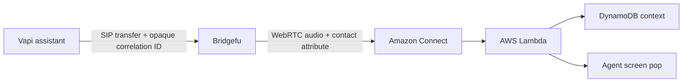

<div align="center">
  

# Bridgefu

**Connect anything.**

</div>

Bridgefu is a Rust media gateway that terminates two call legs and bridges
audio, DTMF, and explicitly allowed context between them. It is built on
[rvoip](https://github.com/eisenzopf/rvoip) and is designed to connect voice AI,
SIP, WebRTC, provider call control, and contact-center systems without making
either side understand the other.

[](media/explainer/bridgefu-explainer.mp4)

[Watch the explainer (MP4)](media/explainer/bridgefu-explainer.mp4) · [English captions](media/explainer/captions.srt)

The first product-qualified deployment target is a Vapi SIP transfer into
Amazon Connect with a correlated agent screen pop:



## Deploy Vapi transfers to Amazon Connect

The customer CloudFormation template, AMI build, Lambdas, Vapi provisioning,
and full live qualification harness live in the dedicated
[bridgefu-vapi-awsconnect](https://github.com/eisenzopf/bridgefu-vapi-awsconnect)
repository. That is the canonical place to deploy and operate this integration.

This repository owns the Bridgefu runtime and its built-in declarative recipe
contract. The deployment repository pins an immutable Bridgefu commit and
builds the customer AMIs from it.

## SIP security modes

- `sips_srtp` — TLS signaling and SDES-SRTP are required. This is the secure
  default.
- `sips_optional_srtp` — TLS signaling is required; Bridgefu negotiates SRTP
  when the peer offers it and accepts RTP/AVP otherwise. Use this deliberately
  for peers such as the currently observed Vapi transfer path that do not offer
  SRTP in SDP.
- `sip_rtp` — clear SIP and RTP. This is an explicit diagnostic compatibility
  posture, not the production default.

Managed SIPS recipes use one-use attachment URIs. Explicit external recipes can
use a trusted-source fixed URI with configurable context headers. Both advertise
a DNS `sips:` Contact; Bridgefu does not silently downgrade signaling from TLS.

For complete configurable Vapi → Amazon Connect setups, see the
[SIP-header and optional correlation-ID examples](examples/vapi-amazon-connect/README.md).

## Try SIP ↔ WebRTC locally

With [Rust 1.95+, a C/C++ toolchain, and protobuf installed](examples/native-sip-webrtc/README.md#start-with-the-local-demo), run this **one line from the repository root**:

```sh
cargo run --locked --example native-sip-webrtc -- --settings examples/sip-to-webrtc/settings.example.json
```

It makes a real encrypted SIP → WebRTC call, verifies audio both ways, prints
**PASS**, and stops all demo endpoints. No cloud account or credentials are needed.
The first build can take several minutes. Change settings or try the reverse direction:

- [SIP caller → WebRTC service](examples/sip-to-webrtc/README.md)
- [WebRTC caller → SIP destination](examples/webrtc-to-sip/README.md)

Each guide includes a one-command demo, editable endpoint configuration, and
step-by-step setup. The [eight-case end-to-end matrix](examples/native-sip-webrtc/README.md#repeat-the-end-to-end-tests)
checks both codecs, both hangup directions, audio, and cleanup.

## Local development

This TURN candidate pins every rvoip component to one immutable revision based
on `0.5.0`, recorded in `config/rvoip-source.txt` and `Cargo.lock`. No sibling
checkout is needed. See [Connect TURN setup and validation](docs/connect-turn.md).

```bash
cargo test --locked
cargo clippy --locked --all-targets -- -D warnings
```

Inspect the embedded, credential-free recipe catalog with:

```bash
cargo run -- recipe available
cargo run -- recipe show builtin:vapi-amazon-connect-screen-pop@1
cargo run -- recipe validate builtin:vapi-amazon-connect-screen-pop@1 \
  --values recipes/vapi-amazon-connect-screen-pop/values.example.yaml
```

Low-level configuration remains available for custom integrations. Start with
[the product overview](docs/product-overview.md), [architecture](docs/architecture.md),
[configuration schema](config/schema.json), and [security model](docs/security.md).

Bridgefu is MIT licensed. See [CONTRIBUTING.md](CONTRIBUTING.md) for development
and security-reporting expectations.
